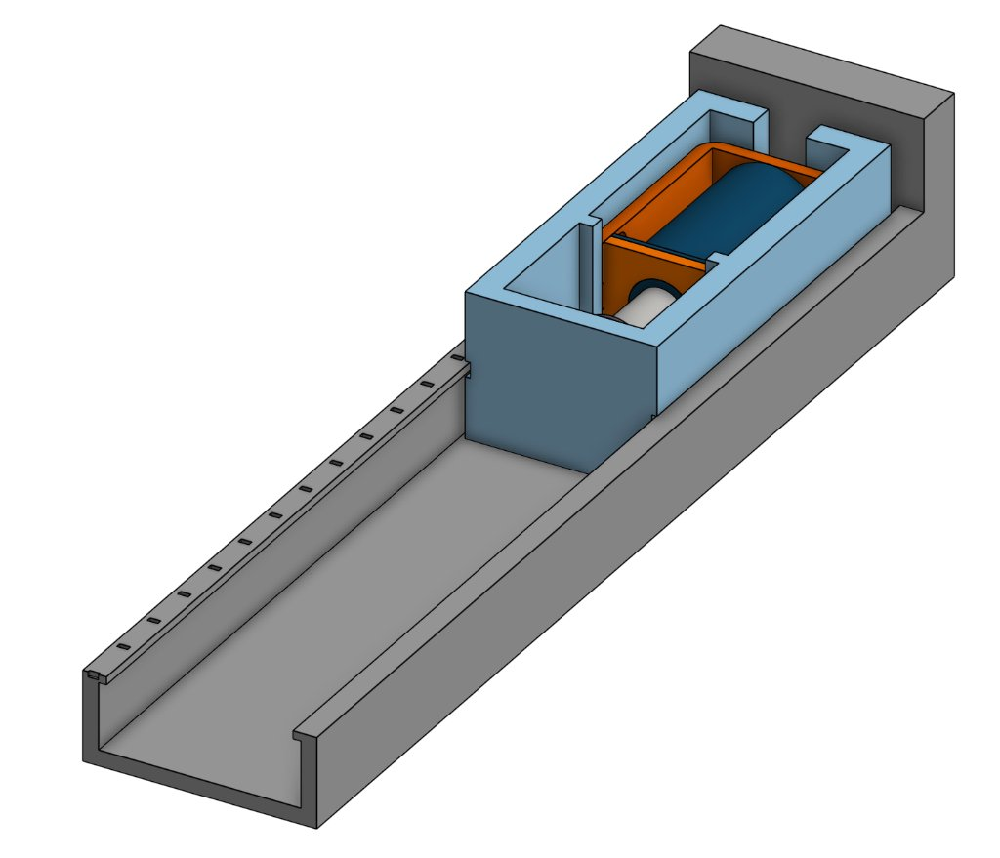
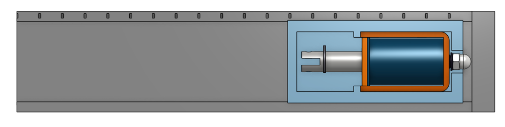
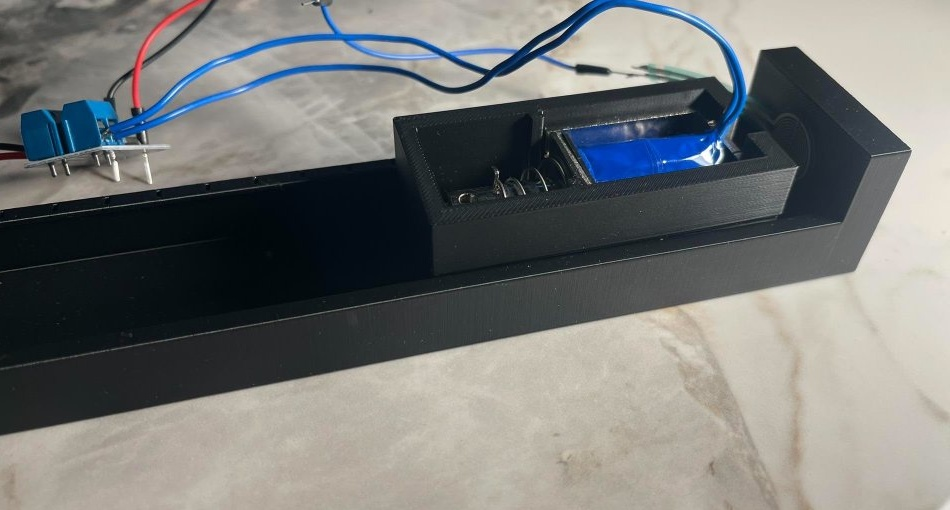
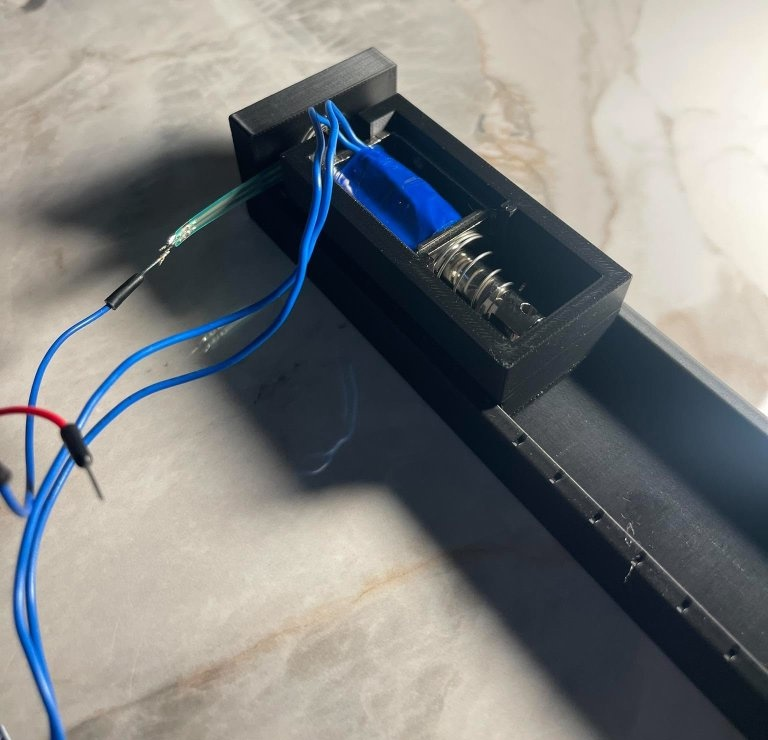
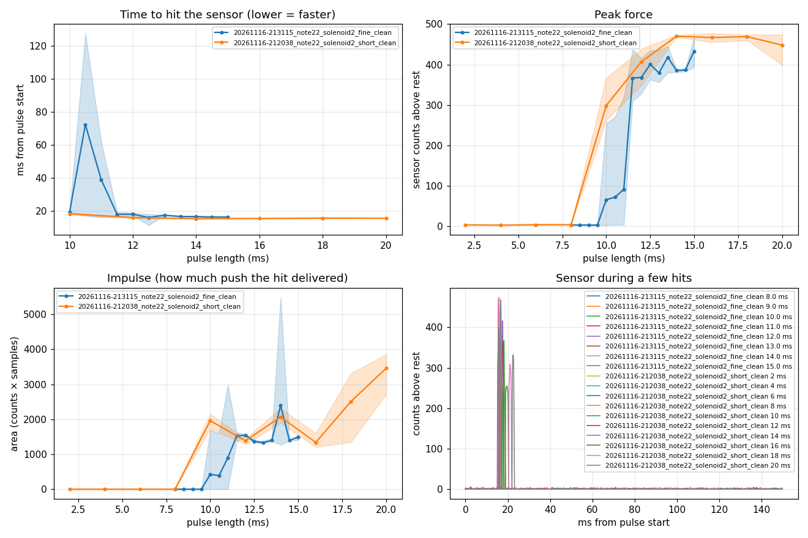

# Piano Solenoid Characterization

This repository contains the firmware, characterization suite, CAD models, and experimental data used to characterize the JF-1039B solenoids for an automated piano-playing system.

## Problem Statement
To play a piano with musical expression, we need to control the strike force and speed of each key. Solenoids do not have built-in velocity feedback. This project establishes the relationship between electrical input signals (pulse length and PWM duty cycle) and mechanical output (plunger velocity and impact force) using an experimental test bench.

## Team Contributions
* Christopher Koo: Led electrical component selection and wiring, designed the Onshape test fixture, and wrote the initial firmware.
* Jonathan Zhou (https://github.com/JonZ21): Collaborated on the firmware architecture, characterization test scripts, data analysis, and documentation.

## Test Bench Architecture

Control path:
```text
Computer (USB Serial) 
  --> Arduino Nano Every 
  --> I2C Bus (100 kHz) 
  --> PCA9685 PWM Driver (0x40) 
  --> MOSFET Driver Module 
  --> Solenoid (24 V DC)
```

Sensor measurement path:
```text
Solenoid Plunger 
  --> FSR 402 Force Sensor (mounted on fixture stop) 
  --> Voltage Divider (10 kOhm reference resistor) 
  --> Arduino Analog Pin A0 (sampled at 5 kHz)
```

## Mechanical Test Fixture
The CAD fixture files, 3D printable STL models, and photos are located in `fixture/`.



Key features:
* Indexed Rail: The guide track features evenly spaced indexing notches along the upper edge. This allows setting exact plunger-to-sensor gaps (e.g., 2 mm, 4 mm, 8 mm) repeatably without manual caliper measurements between runs.
* Sled: A rigid carriage secures the solenoid frame using the rear threaded stud and lock nut, preventing torque and misalignment during impacts.
* Stop Anvil: Holds the 0.5-inch FSR 402 force-sensing resistor perpendicular to the strike axis.
* Sled Iterations: Includes `ver2` and `Ver3` slider revisions in `fixture/` with adjusted clearances for 3D print tolerances.


*Top view showing discrete indexing notches along the upper rail.*


*Side view showing slider carriage engagement with the guide rail.*

### Physical 3D-Printed Test Bench

*Physical test rig showing the MOSFET driver board (left), indexed guide rail, solenoid carriage, and circular FSR 402 sensor mounted on the end stop.*


*Close-up of the solenoid carriage showing the plunger return spring, coil wiring, and sensor leads.*

## Experimental Results Summary
Physical tests were performed on a 24 V supply using solenoid 2 (MIDI note 22) and an FSR 402 sensor. Raw data, filtered sweeps, and comparison plots are saved in `firmware/characterize/results/`.


*Experimental sweep comparison showing time to contact, peak force, impulse, and raw sensor traces.*

Key findings:
* Coil Resistance: Measured cold at 25.4 Ohms, drawing 0.95 A at 24 V (23 W peak electrical power).
* Plunger Flight Time: The plunger takes between 15.0 ms and 18.0 ms to travel across the gap and hit the sensor.
* Saturation Threshold: Any pulse longer than 14 ms delivers maximum force. Extra on-time does not increase striking volume because the plunger has already hit the target; it only causes coil heating and rebound rattle.
* Narrow Usable Band: Pulse duration only alters striking force within a narrow window of roughly 11.5 ms to 13.5 ms. Below 10 ms, the plunger does not reach the sensor.
* Temperature Sensitivity: The threshold shifted by about 1.5 ms between cold and warm trials, proving that pulse duration alone cannot reliably map 127 MIDI velocities.
* Control Strategy: Velocity control must be achieved by modulating PWM duty cycle (power level) during the strike. Flyback diodes must be placed across each coil to protect the MOSFET switches from inductive voltage spikes during PWM switching.

## 3 Things Learnt
1. Pulse duration alone cannot control volume because once the pulse outlasts the plunger travel (about 14 ms), extra duration adds no force.
2. Inductive loads generate high-voltage kickback when turned off, requiring flyback diodes to prevent ground bounce and chip resets.
3. Precise physical timing and 5 kHz sensor capture must run directly on the microcontroller firmware because computer USB serial communication has unpredictable latency.

## 3 Things to Improve Next Time
1. Simplify the initial circuit by testing with just the Arduino and a single MOSFET directly before introducing intermediate I2C boards.
2. Add a return spring or automatic locating stop on the fixture so the plunger resets automatically between test strikes.
3. Use proper crimp connectors and heat shrink on the flexible sensor tabs rather than soldering directly, which broke during testing and required a clip.

## How to Run

### 1. Upload Firmware
Connect the Arduino Nano Every via USB:
```bash
./upload.sh
```

### 2. Run Characterization Commands
```bash
# Verify resting sensor baseline on A0
python3 firmware/characterize/characterize.py check

# Fire single test hit on note 22 for 12 ms
python3 firmware/characterize/characterize.py hit 22 12

# Run an automated pulse sweep from 8 ms to 16 ms in 0.5 ms steps
python3 firmware/characterize/characterize.py sweep 22 --from 8 --to 16 --step 0.5

# Filter out rattles and generate cleaned comparison plots
python3 firmware/characterize/characterize.py clean firmware/characterize/results/<run_file>.csv

# Compare multiple sweeps on one graph
python3 firmware/characterize/characterize.py plot firmware/characterize/results/A.csv firmware/characterize/results/B.csv
```
